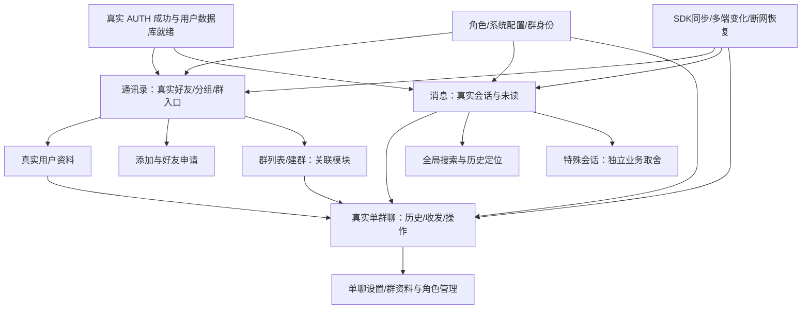

# 通讯录与消息迁移需求总纲（旧 xgd → 新 ddlNew）

> 状态：需求整理，待用户审阅。日期：2026-10-13。作者：Agency Agents 产品经理（Codex）。新项目基线：`feature-message-4`，`78876ca`，以当前工作树为准。旧项目基线：`xgd / 5e45f3f`，以当前只读工作树为准。旧项目由用户指定为 `/Users/taobotaobo/Desktop/xgd`，优先于交接文档历史 `/Desktop/ddl` 地址。

## 1. 用户价值与问题

用户需要在新项目继续使用旧项目的真实好友关系和消息能力：找到联系人、处理好友申请、从资料发起聊天、读取历史和收发消息、管理会话，并在权限、断网和多端同步变化时看到可信的状态。当前新项目已接好友与会话只读数据，操作入口和真实聊天链路仍缺失；本需求将旧实现拆成可逐项审阅、开发和验收的业务合同，避免把演示页面或 SDK 的存在误认为产品已经完成迁移。

**迁移价值说明（需求版）**：新通讯录和消息页将让已登录用户继续访问真实好友、群和历史会话，通过清晰的资料、申请与聊天入口完成沟通；关系变化、消息状态、角色限制和网络恢复会同步反映在页面上。用户能区分已发送、失败、未读和无权限，不会因缓存或演示数据产生误判。该段描述为目标，尚未发布或实现承诺。

## 2. 阅读目录

- [通讯录详细需求](CONTACTS_MIGRATION_REQUIREMENTS.md)：好友列表、业务分组、群入口、搜索、添加/申请、资料与设置、跨端关系变化。
- [消息及关联真实聊天详细需求](MESSAGE_MIGRATION_REQUIREMENTS.md)：会话列表、操作、搜索、特殊会话、历史和收发、消息操作、单群聊详情与权限依赖。
- [完整差距及验收索引](#需求索引)：逐条状态、建议优先级、章节与验收编号。
- [跨模块依赖](#跨模块依赖)、[建议迁移边界](#建议迁移边界)、[待确认与待联调](#待确认与待联调)、[统计与文档验证](#统计与文档验证)。

图中是目标关系，箭头不表示已实现；已接状态以第5节索引为准。

## 3. 证据、状态与范围约定

本轮仅进行静态源码对照和文档检查，没有运行旧 App、构建新 App、执行消息业务测试、连接真实后端或进行真机联调。验收案例是后续测试设计，不是本轮通过记录。源码可达、请求调用存在，也不能证明服务端当前支持或旧 App 运行成功。接口参数、数量限制、协议值只有明确源码依据时才记录数字；服务端配额、错误映射和版本差异仍须联调。

新状态统一为：**已接（代码）**＝真实主入口已接 SDK 数据或真实业务；**部分**＝有真实展示/桥接或权限模型，但关键操作缺失；**未接**＝主入口缺少真实闭环；**需取舍**＝旧能力存在但本次仅盘点，是否迁移须用户另行决策。这些状态不等于真机验收。演示 `OriginalContactsView`、`OriginalMessagesView`、`ChatScreen` 和 `ClubCommunity` 不计真实迁移完成度。

建议优先级统一为：P0＝维护已接数据正确性/会话安全；P1＝基础通讯录与真实聊天闭环；P2＝扩展操作、搜索和群管理；P3＝独立业务或投入较大的扩展。优先级为产品建议，**不代表用户批准开发**。详细文档使用 C-（通讯录）、M-（消息页）、CHAT-（关联聊天）ID；每项验收编号为 `需求ID-A1/A2/...`，统一异常验收还需覆盖本文公共标准。

本轮明确保留用户既有边界：不恢复已删除的演示拉黑/举报；旧真实拉黑/举报只作能力盘点、后续取舍；好友业务二维码与已暂缓的导航/邀请码扫码分开；手机号/邮箱登录暂缓不等于通讯录账号搜索业务禁止；通话、支付、团队等关联模块只写依赖和旧入口，不自动纳入全量开发。

## 4. 当前真实入口与证据

- [TabbarView.swift](/Users/taobotaobo/Desktop/ddlNew/ddlNew/Features/Tabbar/Views/TabbarView.swift:25)：消息和通讯录分别进入真实 `MessageView`、`ContactsView`；角标来自 ConversationsStore。
- [ContactsView.swift](/Users/taobotaobo/Desktop/ddlNew/ddlNew/Features/Contacts/Views/ContactsView.swift:18)：真实好友列表、搜索、计数和详情 sheet。
- [ContactRecordDetailView.swift](/Users/taobotaobo/Desktop/ddlNew/ddlNew/Features/Contacts/Views/ContactRecordDetailView.swift:19)：只读当前好友快照，没有真实发消息/备注提交入口。
- [MessageView.swift](/Users/taobotaobo/Desktop/ddlNew/ddlNew/Features/Message/Views/MessageView.swift:25)：搜索会话名称/预览及全部/未读筛选；列表行尚无聊天导航或会话操作。
- [ChatScreen.swift](/Users/taobotaobo/Desktop/ddlNew/ddlNew/Features/Message/Views/ChatScreen.swift:13)：输入、草稿与发送调用 ClubCommunity，仅演示链路。
- [UserRoleAuthority.swift](/Users/taobotaobo/Desktop/ddlNew/ddlNew/Common/User/UserRoleAuthority.swift:16)：保留角色权限、configData 和 authorityKey；有字段不等于功能已消费该权限。

## 5. 完整差距及验收索引

以下按正式需求ID列出**全部116项**；旧状态是静态可达/调用证据，新状态是当前真实业务入口，不等于运行验证。点击章节可查看流程、字段、异常和真实源码；每项两条正式验收另加公共C-G/M-G标准。

### 通讯录：38项

| ID与章节 | 旧项目状态（静态） | 新真实状态 | 建议优先级/取舍 | 验收索引 |
| --- | --- | --- | --- | --- |
| [C-001 页面入口、好友/业务分组/群聊切换](CONTACTS_MIGRATION_REQUIREMENTS.md#C-001) | 真实页面/调用已见，详章节 | 部分 | P1；建议迁移 | C-001-A1/A2 + C-G1～G10 |
| [C-002 好友名单、名称优先级与排序](CONTACTS_MIGRATION_REQUIREMENTS.md#C-002) | 真实页面/调用已见，详章节 | 已接（代码） | P0；建议迁移 | C-002-A1/A2 + C-G1～G10 |
| [C-003 好友在线、注销及异常账号状态](CONTACTS_MIGRATION_REQUIREMENTS.md#C-003) | 列表在线点未赋值；资料在线已见 | 部分 | P0；建议迁移 | C-003-A1/A2 + C-G1～G10 |
| [C-004 真实头像、文件Host变化与图片降级](CONTACTS_MIGRATION_REQUIREMENTS.md#C-004) | 真实页面/调用已见，详章节 | 已接（代码） | P0；建议迁移 | C-004-A1/A2 + C-G1～G10 |
| [C-005 SDK同步、错误恢复和跨账号隔离](CONTACTS_MIGRATION_REQUIREMENTS.md#C-005) | 真实页面/调用已见，详章节 | 已接（代码） | P0；建议迁移 | C-005-A1/A2 + C-G1～G10 |
| [C-006 本地好友检索与旧全局好友检索差异](CONTACTS_MIGRATION_REQUIREMENTS.md#C-006) | 旧全局搜索更窄且过滤注销 | 部分 | P1；建议迁移 | C-006-A1/A2 + C-G1～G10 |
| [C-007 首字母快速定位](CONTACTS_MIGRATION_REQUIREMENTS.md#C-007) | 真实页面/调用已见，详章节 | 未接 | P2；建议迁移 | C-007-A1/A2 + C-G1～G10 |
| [C-008 新朋友入口、申请未读与通讯录角标](CONTACTS_MIGRATION_REQUIREMENTS.md#C-008) | 真实页面/调用已见，详章节 | 未接 | P1；建议迁移 | C-008-A1/A2 + C-G1～G10 |
| [C-009 好友申请列表、分页与状态](CONTACTS_MIGRATION_REQUIREMENTS.md#C-009) | 真实页面/调用已见，详章节 | 未接 | P1；建议迁移 | C-009-A1/A2 + C-G1～G10 |
| [C-010 同意好友申请与完整好友落库](CONTACTS_MIGRATION_REQUIREMENTS.md#C-010) | 真实页面/调用已见，详章节 | 未接 | P1；建议迁移 | C-010-A1/A2 + C-G1～G10 |
| [C-011 申请详情、重新申请与发消息分支](CONTACTS_MIGRATION_REQUIREMENTS.md#C-011) | 真实页面/调用已见，详章节 | 未接 | P1；建议迁移 | C-011-A1/A2 + C-G1～G10 |
| [C-012 申请本地隐藏与“拒绝”证据边界](CONTACTS_MIGRATION_REQUIREMENTS.md#C-012) | 只本地隐藏；无好友拒绝证据 | 未接 | P2；本地隐藏建议迁移；服务端拒绝待取舍 | C-012-A1/A2 + C-G1～G10 |
| [C-013 按账号/手机号/邮箱查找用户](CONTACTS_MIGRATION_REQUIREMENTS.md#C-013) | 真实页面/调用已见，详章节 | 未接 | P1；建议迁移 | C-013-A1/A2 + C-G1～G10 |
| [C-014 发送添加好友申请与权限统一](CONTACTS_MIGRATION_REQUIREMENTS.md#C-014) | 真实页面/调用已见，详章节 | 未接 | P1；建议迁移 | C-014-A1/A2 + C-G1～G10 |
| [C-015 本人/陌生人/群成员资料关系判断](CONTACTS_MIGRATION_REQUIREMENTS.md#C-015) | 真实页面/调用已见，详章节 | 未接 | P1；建议迁移 | C-015-A1/A2 + C-G1～G10 |
| [C-016 好友资料展示、现场刷新与实时变化](CONTACTS_MIGRATION_REQUIREMENTS.md#C-016) | 真实页面/调用已见，详章节 | 部分 | P1；建议迁移 | C-016-A1/A2 + C-G1～G10 |
| [C-017 编辑备注与备注描述](CONTACTS_MIGRATION_REQUIREMENTS.md#C-017) | 真实页面/调用已见，详章节 | 部分 | P1；建议迁移 | C-017-A1/A2 + C-G1～G10 |
| [C-018 推荐好友名片](CONTACTS_MIGRATION_REQUIREMENTS.md#C-018) | 真实页面/调用已见，详章节 | 未接 | P2；建议迁移（依赖CHAT名片） | C-018-A1/A2 + C-G1～G10 |
| [C-019 删除好友、审核受理与聊天记录清理](CONTACTS_MIGRATION_REQUIREMENTS.md#C-019) | 真实页面/调用已见，详章节 | 未接 | P2；建议迁移 | C-019-A1/A2 + C-G1～G10 |
| [C-020 真实黑名单能力盘点](CONTACTS_MIGRATION_REQUIREMENTS.md#C-020) | 真实页面/调用已见，详章节 | 需取舍 | P3；仅盘点，用户后续取舍 | C-020-A1/A2 + C-G1～G10 |
| [C-021 真实投诉/举报表单与上传依赖盘点](CONTACTS_MIGRATION_REQUIREMENTS.md#C-021) | 真实页面/调用已见，详章节 | 需取舍 | P3；仅盘点，用户后续取舍 | C-021-A1/A2 + C-G1～G10 |
| [C-022 好友业务分组、默认组与展开收起](CONTACTS_MIGRATION_REQUIREMENTS.md#C-022) | 真实页面/调用已见，详章节 | 未接 | P2；建议迁移 | C-022-A1/A2 + C-G1～G10 |
| [C-023 创建、改名与删除业务分组](CONTACTS_MIGRATION_REQUIREMENTS.md#C-023) | 真实页面/调用已见，详章节 | 未接 | P2；建议迁移 | C-023-A1/A2 + C-G1～G10 |
| [C-024 业务分组排序管理](CONTACTS_MIGRATION_REQUIREMENTS.md#C-024) | 真实页面/调用已见，详章节 | 未接 | P2；建议迁移 | C-024-A1/A2 + C-G1～G10 |
| [C-025 将好友移动到业务分组](CONTACTS_MIGRATION_REQUIREMENTS.md#C-025) | 真实页面/调用已见，详章节 | 未接 | P2；建议迁移 | C-025-A1/A2 + C-G1～G10 |
| [C-026 真实群列表与成员关系同步](CONTACTS_MIGRATION_REQUIREMENTS.md#C-026) | 真实页面/调用已见，详章节 | 未接 | P1；建议迁移 | C-026-A1/A2 + C-G1～G10 |
| [C-027 全局群搜索与群聊天定位](CONTACTS_MIGRATION_REQUIREMENTS.md#C-027) | 真实页面/调用已见，详章节 | 未接 | P2；建议迁移 | C-027-A1/A2 + C-G1～G10 |
| [C-028 建群选人、最近联系人及跨列表选中](CONTACTS_MIGRATION_REQUIREMENTS.md#C-028) | 真实页面/调用已见，详章节 | 未接 | P2；建议迁移 | C-028-A1/A2 + C-G1～G10 |
| [C-029 创建群请求、返回与真实群聊天](CONTACTS_MIGRATION_REQUIREMENTS.md#C-029) | 真实页面/调用已见，详章节 | 未接 | P2；建议迁移 | C-029-A1/A2 + C-G1～G10 |
| [C-030 本人好友二维码、复制账号与保存分享](CONTACTS_MIGRATION_REQUIREMENTS.md#C-030) | 真实页面/调用已见，详章节 | 未接 | P2；建议迁移 | C-030-A1/A2 + C-G1～G10 |
| [C-031 业务扫码添加好友及其他结果分流](CONTACTS_MIGRATION_REQUIREMENTS.md#C-031) | 真实页面/调用已见，详章节 | 未接 | P2；建议迁移业务扫码；导航/PC等另取舍 | C-031-A1/A2 + C-G1～G10 |
| [C-032 群二维码、扫码入群与待审核](CONTACTS_MIGRATION_REQUIREMENTS.md#C-032) | 真实页面/调用已见，详章节 | 未接 | P2；建议迁移（依赖群资料/审批） | C-032-A1/A2 + C-G1～G10 |
| [C-033 通讯录文件助手入口与权限](CONTACTS_MIGRATION_REQUIREMENTS.md#C-033) | 真实页面/调用已见，详章节 | 未接 | P2；建议迁移 | C-033-A1/A2 + C-G1～G10 |
| [C-034 通讯录群助手/群系统通知入口](CONTACTS_MIGRATION_REQUIREMENTS.md#C-034) | 真实页面/调用已见，详章节 | 未接 | P2；建议迁移（依赖M-021） | C-034-A1/A2 + C-G1～G10 |
| [C-035 我的团队与团队建群边界](CONTACTS_MIGRATION_REQUIREMENTS.md#C-035) | Mine团队可达；旧团队Tab注释 | 需取舍 | P3；仅关联盘点，用户后续取舍 | C-035-A1/A2 + C-G1～G10 |
| [C-036 角色、系统配置与群成员访问统一守卫](CONTACTS_MIGRATION_REQUIREMENTS.md#C-036) | 真实页面/调用已见，详章节 | 部分 | P0；建议迁移 | C-036-A1/A2 + C-G1～G10 |
| [C-037 空态、取消、键盘与可访问性](CONTACTS_MIGRATION_REQUIREMENTS.md#C-037) | 真实页面/调用已见，详章节 | 部分 | P1；建议迁移 | C-037-A1/A2 + C-G1～G10 |
| [C-038 好友发真实消息与音视频入口依赖](CONTACTS_MIGRATION_REQUIREMENTS.md#C-038) | 真实页面/调用已见，详章节 | 未接 | P1；真实聊天建议迁移；通话另行取舍 | C-038-A1/A2 + C-G1～G10 |

### 消息Tab：29项

| ID与章节 | 旧项目状态（静态） | 新真实状态 | 建议优先级/取舍 | 验收索引 |
| --- | --- | --- | --- | --- |
| [M-001 真实会话首次加载与有效类型过滤](MESSAGE_MIGRATION_REQUIREMENTS.md#M-001) | 真实页面/调用已见，详章节 | 已接（代码） | P0；建议迁移 | M-001-A1/A2 + M-G1～G11 |
| [M-002 置顶分区、时间排序与稳定去重](MESSAGE_MIGRATION_REQUIREMENTS.md#M-002) | 真实页面/调用已见，详章节 | 已接（代码） | P0；建议迁移 | M-002-A1/A2 + M-G1～G11 |
| [M-003 单群聊标题、备注与真实头像优先级](MESSAGE_MIGRATION_REQUIREMENTS.md#M-003) | 真实页面/调用已见，详章节 | 部分 | P1；建议迁移 | M-003-A1/A2 + M-G1～G11 |
| [M-004 最新预览、群发送者、@与特殊消息摘要](MESSAGE_MIGRATION_REQUIREMENTS.md#M-004) | 真实页面/调用已见，详章节 | 部分 | P1；建议迁移 | M-004-A1/A2 + M-G1～G11 |
| [M-005 会话时间格式、校时与缺值](MESSAGE_MIGRATION_REQUIREMENTS.md#M-005) | 真实页面/调用已见，详章节 | 部分 | P1；建议迁移 | M-005-A1/A2 + M-G1～G11 |
| [M-006 未读行、手动提醒、免打扰与Tab角标](MESSAGE_MIGRATION_REQUIREMENTS.md#M-006) | 真实页面/调用已见，详章节 | 部分 | P0；建议迁移 | M-006-A1/A2 + M-G1～G11 |
| [M-007 同步进度、连接提示与缓存错误恢复](MESSAGE_MIGRATION_REQUIREMENTS.md#M-007) | 真实页面/调用已见，详章节 | 部分 | P0；建议迁移 | M-007-A1/A2 + M-G1～G11 |
| [M-008 全部/未读筛选与本地预览搜索](MESSAGE_MIGRATION_REQUIREMENTS.md#M-008) | 新本地筛选；旧三分类搜索 | 已接（代码） | P0；建议迁移 | M-008-A1/A2 + M-G1～G11 |
| [M-009 会话点击、真实路由与进入清读边界](MESSAGE_MIGRATION_REQUIREMENTS.md#M-009) | 真实页面/调用已见，详章节 | 未接 | P1；建议迁移 | M-009-A1/A2 + M-G1～G11 |
| [M-010 会话置顶与取消置顶](MESSAGE_MIGRATION_REQUIREMENTS.md#M-010) | 真实页面/调用已见，详章节 | 未接 | P1；建议迁移 | M-010-A1/A2 + M-G1～G11 |
| [M-011 会话免打扰与取消](MESSAGE_MIGRATION_REQUIREMENTS.md#M-011) | 真实页面/调用已见，详章节 | 未接 | P1；建议迁移 | M-011-A1/A2 + M-G1～G11 |
| [M-012 手动标记未读/已读与读游标](MESSAGE_MIGRATION_REQUIREMENTS.md#M-012) | 真实页面/调用已见，详章节 | 未接 | P1；建议迁移 | M-012-A1/A2 + M-G1～G11 |
| [M-013 删除会话且保留历史](MESSAGE_MIGRATION_REQUIREMENTS.md#M-013) | 真实页面/调用已见，详章节 | 未接 | P1；建议迁移 | M-013-A1/A2 + M-G1～G11 |
| [M-014 全会话已读同步能力与主动入口待确认](MESSAGE_MIGRATION_REQUIREMENTS.md#M-014) | SDK/代理已见；主动全读UI未证 | 部分 | P2；事件建议保留；主动入口待取舍 | M-014-A1/A2 + M-G1～G11 |
| [M-015 真实草稿、@片段与恢复来源差异](MESSAGE_MIGRATION_REQUIREMENTS.md#M-015) | 真实页面/调用已见，详章节 | 部分 | P1；建议迁移 | M-015-A1/A2 + M-G1～G11 |
| [M-016 全局搜索三分类与更多](MESSAGE_MIGRATION_REQUIREMENTS.md#M-016) | 真实页面/调用已见，详章节 | 未接 | P2；建议迁移 | M-016-A1/A2 + M-G1～G11 |
| [M-017 搜索好友/群/助手的目标分流与权限](MESSAGE_MIGRATION_REQUIREMENTS.md#M-017) | 真实页面/调用已见，详章节 | 未接 | P2；建议迁移 | M-017-A1/A2 + M-G1～G11 |
| [M-018 消息搜索命中、补页与原消息定位](MESSAGE_MIGRATION_REQUIREMENTS.md#M-018) | 真实页面/调用已见，详章节 | 未接 | P2；建议迁移 | M-018-A1/A2 + M-G1～G11 |
| [M-019 文件助手专用真实会话](MESSAGE_MIGRATION_REQUIREMENTS.md#M-019) | 真实页面/调用已见，详章节 | 部分 | P2；建议独立迁移 | M-019-A1/A2 + M-G1～G11 |
| [M-020 群发助手、收件人选择和部分失败](MESSAGE_MIGRATION_REQUIREMENTS.md#M-020) | 真实页面/调用已见，详章节 | 未接 | P3；独立范围，用户后续取舍 | M-020-A1/A2 + M-G1～G11 |
| [M-021 群系统通知、申请同意/拒绝与批量审核](MESSAGE_MIGRATION_REQUIREMENTS.md#M-021) | 真实页面/调用已见，详章节 | 未接 | P2；建议独立迁移 | M-021-A1/A2 + M-G1～G11 |
| [M-022 签到提醒历史与真实签到依赖](MESSAGE_MIGRATION_REQUIREMENTS.md#M-022) | 旧签到可达；新ID合并缺方法 | 部分 | P3；独立签到范围，用户后续取舍 | M-022-A1/A2 + M-G1～G11 |
| [M-023 支付助手类型与不可达边界](MESSAGE_MIGRATION_REQUIREMENTS.md#M-023) | 类型有；旧Home过滤无跳转 | 需取舍 | P3；仅类型盘点，用户后续取舍 | M-023-A1/A2 + M-G1～G11 |
| [M-024 更多菜单、添加/创建群/业务扫码/群发](MESSAGE_MIGRATION_REQUIREMENTS.md#M-024) | 真实页面/调用已见，详章节 | 未接 | P2；建议迁移 | M-024-A1/A2 + M-G1～G11 |
| [M-025 双击消息Tab循环定位未读](MESSAGE_MIGRATION_REQUIREMENTS.md#M-025) | 真实页面/调用已见，详章节 | 未接 | P2；交互保留待用户审阅 | M-025-A1/A2 + M-G1～G11 |
| [M-026 多端会话事件、删除与退出清理](MESSAGE_MIGRATION_REQUIREMENTS.md#M-026) | 真实页面/调用已见，详章节 | 已接（代码） | P0；建议迁移 | M-026-A1/A2 + M-G1～G11 |
| [M-027 消息角色权限与系统业务配置缺口](MESSAGE_MIGRATION_REQUIREMENTS.md#M-027) | 真实页面/调用已见，详章节 | 部分 | P0；建议迁移 | M-027-A1/A2 + M-G1～G11 |
| [M-028 加载/空/错误、键盘和可访问性](MESSAGE_MIGRATION_REQUIREMENTS.md#M-028) | 基本状态可见；完整无障碍未证 | 部分 | P1；建议迁移 | M-028-A1/A2 + M-G1～G11 |
| [M-029 通知/深链打开真实会话与Badge依赖](MESSAGE_MIGRATION_REQUIREMENTS.md#M-029) | 通知/深链完整链未独立确认 | 需取舍 | P2；推送/深链独立待确认 | M-029-A1/A2 + M-G1～G11 |

### 关联真实聊天：49项

| ID与章节 | 旧项目状态（静态） | 新真实状态 | 建议优先级/取舍 | 验收索引 |
| --- | --- | --- | --- | --- |
| [CHAT-001 真实单群聊建立与路由上下文](MESSAGE_MIGRATION_REQUIREMENTS.md#CHAT-001) | 真实页面/调用已见，详章节 | 未接 | P1；建议迁移 | CHAT-001-A1/A2 + M-G1～G11 |
| [CHAT-002 历史首屏、本地缓存与100条游标分页](MESSAGE_MIGRATION_REQUIREMENTS.md#CHAT-002) | 真实页面/调用已见，详章节 | 未接 | P1；建议迁移 | CHAT-002-A1/A2 + M-G1～G11 |
| [CHAT-003 滚动位置、新消息提示与搜索定位](MESSAGE_MIGRATION_REQUIREMENTS.md#CHAT-003) | 真实页面/调用已见，详章节 | 未接 | P1；建议迁移 | CHAT-003-A1/A2 + M-G1～G11 |
| [CHAT-004 实时收消息、双ID去重与状态事件分流](MESSAGE_MIGRATION_REQUIREMENTS.md#CHAT-004) | 真实页面/调用已见，详章节 | 未接 | P1；建议迁移 | CHAT-004-A1/A2 + M-G1～G11 |
| [CHAT-005 发送落库、发送中/成功/失败与ACK重排](MESSAGE_MIGRATION_REQUIREMENTS.md#CHAT-005) | 真实页面/调用已见，详章节 | 未接 | P1；建议迁移 | CHAT-005-A1/A2 + M-G1～G11 |
| [CHAT-006 SDK失败分类、ACK重试与人工重发](MESSAGE_MIGRATION_REQUIREMENTS.md#CHAT-006) | 真实页面/调用已见，详章节 | 未接 | P1；建议迁移 | CHAT-006-A1/A2 + M-G1～G11 |
| [CHAT-007 正文可见批量已读、语音播放与已读提示](MESSAGE_MIGRATION_REQUIREMENTS.md#CHAT-007) | 真实页面/调用已见，详章节 | 未接 | P1；建议迁移 | CHAT-007-A1/A2 + M-G1～G11 |
| [CHAT-008 消息日期分隔、服务端校时与气泡基础](MESSAGE_MIGRATION_REQUIREMENTS.md#CHAT-008) | 真实页面/调用已见，详章节 | 未接 | P1；建议迁移 | CHAT-008-A1/A2 + M-G1～G11 |
| [CHAT-009 文本、Unicode emoji、敏感处理与输入恢复](MESSAGE_MIGRATION_REQUIREMENTS.md#CHAT-009) | 真实页面/调用已见，详章节 | 未接 | P1；建议迁移 | CHAT-009-A1/A2 + M-G1～G11 |
| [CHAT-010 @选择、@所有人、片段编辑与限制](MESSAGE_MIGRATION_REQUIREMENTS.md#CHAT-010) | 真实页面/调用已见，详章节 | 未接 | P2；建议迁移 | CHAT-010-A1/A2 + M-G1～G11 |
| [CHAT-011 语音录制、取消、上传、播放与已读](MESSAGE_MIGRATION_REQUIREMENTS.md#CHAT-011) | 真实页面/调用已见，详章节 | 未接 | P2；建议迁移 | CHAT-011-A1/A2 + M-G1～G11 |
| [CHAT-012 相册/拍摄图片视频、转换文件与上传任务](MESSAGE_MIGRATION_REQUIREMENTS.md#CHAT-012) | 真实页面/调用已见，详章节 | 未接 | P2；建议迁移 | CHAT-012-A1/A2 + M-G1～G11 |
| [CHAT-013 文件选择、上传/下载、文件名与系统打开](MESSAGE_MIGRATION_REQUIREMENTS.md#CHAT-013) | 真实页面/调用已见，详章节 | 未接 | P2；建议迁移 | CHAT-013-A1/A2 + M-G1～G11 |
| [CHAT-014 贴纸/GIF/游戏表情及表情商城](MESSAGE_MIGRATION_REQUIREMENTS.md#CHAT-014) | 真实页面/调用已见，详章节 | 未接 | P2；贴纸建议迁移；商城独立取舍 | CHAT-014-A1/A2 + M-G1～G11 |
| [CHAT-015 真实名片推荐、接收与资料分流](MESSAGE_MIGRATION_REQUIREMENTS.md#CHAT-015) | 真实页面/调用已见，详章节 | 未接 | P2；建议迁移 | CHAT-015-A1/A2 + M-G1～G11 |
| [CHAT-016 历史位置气泡与位置发送待取舍](MESSAGE_MIGRATION_REQUIREMENTS.md#CHAT-016) | 历史/工具有；发送入口未证 | 未接 | P2；历史展示建议迁移；新发位置待取舍 | CHAT-016-A1/A2 + M-G1～G11 |
| [CHAT-017 合并聊天记录呈现与嵌套边界](MESSAGE_MIGRATION_REQUIREMENTS.md#CHAT-017) | 真实页面/调用已见，详章节 | 未接 | P2；建议迁移 | CHAT-017-A1/A2 + M-G1～G11 |
| [CHAT-018 禁言/角色/上传开关与群发送间隔](MESSAGE_MIGRATION_REQUIREMENTS.md#CHAT-018) | 真实页面/调用已见，详章节 | 未接 | P1；建议迁移 | CHAT-018-A1/A2 + M-G1～G11 |
| [CHAT-019 长按菜单矩阵、复制与链接](MESSAGE_MIGRATION_REQUIREMENTS.md#CHAT-019) | 真实页面/调用已见，详章节 | 未接 | P2；建议迁移 | CHAT-019-A1/A2 + M-G1～G11 |
| [CHAT-020 引用回复、原文定位与变更同步](MESSAGE_MIGRATION_REQUIREMENTS.md#CHAT-020) | 真实页面/调用已见，详章节 | 未接 | P2；建议迁移 | CHAT-020-A1/A2 + M-G1～G11 |
| [CHAT-021 单条/多选删除、单向与双向范围](MESSAGE_MIGRATION_REQUIREMENTS.md#CHAT-021) | 真实页面/调用已见，详章节 | 未接 | P2；建议迁移 | CHAT-021-A1/A2 + M-G1～G11 |
| [CHAT-022 撤回窗口、管理者撤回与撤回占位](MESSAGE_MIGRATION_REQUIREMENTS.md#CHAT-022) | 真实页面/调用已见，详章节 | 未接 | P2；建议迁移 | CHAT-022-A1/A2 + M-G1～G11 |
| [CHAT-023 本人文本/@编辑、分钟权限与回写](MESSAGE_MIGRATION_REQUIREMENTS.md#CHAT-023) | 真实页面/调用已见，详章节 | 未接 | P2；建议迁移 | CHAT-023-A1/A2 + M-G1～G11 |
| [CHAT-024 消息多选、100条上限及不可选类型](MESSAGE_MIGRATION_REQUIREMENTS.md#CHAT-024) | 真实页面/调用已见，详章节 | 未接 | P2；建议迁移 | CHAT-024-A1/A2 + M-G1～G11 |
| [CHAT-025 逐条/合并转发、合规预检与逐对象结果](MESSAGE_MIGRATION_REQUIREMENTS.md#CHAT-025) | 真实页面/调用已见，详章节 | 未接 | P2；建议迁移 | CHAT-025-A1/A2 + M-G1～G11 |
| [CHAT-026 消息收藏与保存链接模块](MESSAGE_MIGRATION_REQUIREMENTS.md#CHAT-026) | 真实页面/调用已见，详章节 | 未接 | P2；关联收藏/链接范围待用户审阅 | CHAT-026-A1/A2 + M-G1～G11 |
| [CHAT-027 翻译配置、状态、再次翻译与服务依赖](MESSAGE_MIGRATION_REQUIREMENTS.md#CHAT-027) | 真实页面/调用已见，详章节 | 未接 | P3；独立翻译范围待取舍 | CHAT-027-A1/A2 + M-G1～G11 |
| [CHAT-028 聊天消息置顶、个人/全局与原文定位](MESSAGE_MIGRATION_REQUIREMENTS.md#CHAT-028) | 真实页面/调用已见，详章节 | 未接 | P2；建议迁移 | CHAT-028-A1/A2 + M-G1～G11 |
| [CHAT-029 定时自动删除：1/7/30天与关闭](MESSAGE_MIGRATION_REQUIREMENTS.md#CHAT-029) | 真实页面/调用已见，详章节 | 未接 | P2；自动清理范围待用户审阅 | CHAT-029-A1/A2 + M-G1～G11 |
| [CHAT-030 单聊设置、加好友成群与清空记录](MESSAGE_MIGRATION_REQUIREMENTS.md#CHAT-030) | 真实页面/调用已见，详章节 | 未接 | P2；建议迁移 | CHAT-030-A1/A2 + M-G1～G11 |
| [CHAT-031 会话内文本/媒体/文件分类搜索与成员筛选](MESSAGE_MIGRATION_REQUIREMENTS.md#CHAT-031) | 真实页面/调用已见，详章节 | 未接 | P2；建议迁移 | CHAT-031-A1/A2 + M-G1～G11 |
| [CHAT-032 媒体/文件详情、下载与系统分享打开](MESSAGE_MIGRATION_REQUIREMENTS.md#CHAT-032) | 真实页面/调用已见，详章节 | 未接 | P2；建议迁移 | CHAT-032-A1/A2 + M-G1～G11 |
| [CHAT-033 群设置总入口与0/1/2角色矩阵](MESSAGE_MIGRATION_REQUIREMENTS.md#CHAT-033) | 真实页面/调用已见，详章节 | 未接 | P2；建议迁移 | CHAT-033-A1/A2 + M-G1～G11 |
| [CHAT-034 群头像、群名称与资料编辑权限](MESSAGE_MIGRATION_REQUIREMENTS.md#CHAT-034) | 真实页面/调用已见，详章节 | 未接 | P2；建议迁移 | CHAT-034-A1/A2 + M-G1～G11 |
| [CHAT-035 群成员预览、成员列表、人数与资料守卫](MESSAGE_MIGRATION_REQUIREMENTS.md#CHAT-035) | 真实页面/调用已见，详章节 | 未接 | P2；建议迁移 | CHAT-035-A1/A2 + M-G1～G11 |
| [CHAT-036 我的群昵称、30字符与跨端名称刷新](MESSAGE_MIGRATION_REQUIREMENTS.md#CHAT-036) | 真实页面/调用已见，详章节 | 未接 | P2；建议迁移 | CHAT-036-A1/A2 + M-G1～G11 |
| [CHAT-037 邀请好友进群、排除已有成员及审核原因](MESSAGE_MIGRATION_REQUIREMENTS.md#CHAT-037) | 真实页面/调用已见，详章节 | 未接 | P2；建议迁移 | CHAT-037-A1/A2 + M-G1～G11 |
| [CHAT-038 移除群成员与同时删除其发言](MESSAGE_MIGRATION_REQUIREMENTS.md#CHAT-038) | 真实页面/调用已见，详章节 | 未接 | P2；建议迁移 | CHAT-038-A1/A2 + M-G1～G11 |
| [CHAT-039 群管理菜单与逐项授权](MESSAGE_MIGRATION_REQUIREMENTS.md#CHAT-039) | 真实页面/调用已见，详章节 | 未接 | P2；建议迁移 | CHAT-039-A1/A2 + M-G1～G11 |
| [CHAT-040 全员/单人/永久禁言与解除](MESSAGE_MIGRATION_REQUIREMENTS.md#CHAT-040) | 真实页面/调用已见，详章节 | 未接 | P2；建议迁移 | CHAT-040-A1/A2 + M-G1～G11 |
| [CHAT-041 群入群申请列表、审核与成员同步依赖](MESSAGE_MIGRATION_REQUIREMENTS.md#CHAT-041) | 真实页面/调用已见，详章节 | 未接 | P2；建议迁移 | CHAT-041-A1/A2 + M-G1～G11 |
| [CHAT-042 群主转让与管理员增减](MESSAGE_MIGRATION_REQUIREMENTS.md#CHAT-042) | 真实页面/调用已见，详章节 | 未接 | P2；建议迁移 | CHAT-042-A1/A2 + M-G1～G11 |
| [CHAT-043 群私聊、历史、提示、二维码及通话开关](MESSAGE_MIGRATION_REQUIREMENTS.md#CHAT-043) | 真实页面/调用已见，详章节 | 未接 | P2；建议迁移 | CHAT-043-A1/A2 + M-G1～G11 |
| [CHAT-044 群公告列表、详情、创建编辑删除及已读](MESSAGE_MIGRATION_REQUIREMENTS.md#CHAT-044) | 真实页面/调用已见，详章节 | 未接 | P2；建议迁移 | CHAT-044-A1/A2 + M-G1～G11 |
| [CHAT-045 退出群、转让前置与群主解散](MESSAGE_MIGRATION_REQUIREMENTS.md#CHAT-045) | 真实页面/调用已见，详章节 | 未接 | P2；建议迁移 | CHAT-045-A1/A2 + M-G1～G11 |
| [CHAT-046 音视频发起、群选择与LiveKit/Zego依赖](MESSAGE_MIGRATION_REQUIREMENTS.md#CHAT-046) | 真实页面/调用已见，详章节 | 需取舍 | P3；独立通话范围待取舍 | CHAT-046-A1/A2 + M-G1～G11 |
| [CHAT-047 群机器人只读列表与活跃等级](MESSAGE_MIGRATION_REQUIREMENTS.md#CHAT-047) | 真实页面/调用已见，详章节 | 需取舍 | P3；扩展群能力待取舍 | CHAT-047-A1/A2 + M-G1～G11 |
| [CHAT-048 业务事件、群角色与昵称同步回流合同](MESSAGE_MIGRATION_REQUIREMENTS.md#CHAT-048) | 真实页面/调用已见，详章节 | 未接 | P1；建议迁移 | CHAT-048-A1/A2 + M-G1～G11 |
| [CHAT-049 未知消息、旧消息兼容及生命周期清理](MESSAGE_MIGRATION_REQUIREMENTS.md#CHAT-049) | 类型/属性有；独立发起待证 | 未接 | P1；基础兼容建议迁移；加密/阅后发起另取舍 | CHAT-049-A1/A2 + M-G1～G11 |

## 6. 跨模块依赖

| 依赖 | 使用位置 | 现状与验收责任 |
| --- | --- | --- |
| 登录AUTH与用户数据库 | 所有C/M/CHAT | 真实会话就绪才加载；既有登录/网络链路为依赖，需求不改变入口方案；异步结果绑定UID/邀请码/会话轮次 |
| SDK好友/群/会话/消息库与代理 | 名单、排序、资料、历史、已读、关系变更 | 好友与会话读已接；消息收发/操作需单独桥接；旧同名方法须在新SDK核对签名和回执，不复制旧调用即认成功 |
| 角色权限快照 | 添加好友、建群、删除/远程删除、上传、已读、置顶消息、编辑、助手 | 新权限模型已接18项key，但主业务多数未消费；同时使用configValue/configData/authorityKey，限制不应写死 |
| 系统配置 | 通话、历史清除/撤回/编辑时窗、群功能、二维码、下载/上传 | 刷新框架已接，但SystemConfigRecord尚未映射messageRecallTime/enableAudioAndVideoCalls/video_source_config等聊天字段；需后续按范围映射并联调；不凭UI按钮判断后端开放 |
| 群详情/成员角色 | 群历史、群发送、@、群设置、入群审核/移除/退出 | 需要成员身份/owner/admin/禁言/解散/邀请策略的真实结果；通讯录群入口只引用该依赖 |
| 文件与媒体基础设施 | 头像、图片视频文件、语音、备注图片、二维码相册 | 当前导航Host已有；上传/下载、缓存、相机/相册/麦克风、资源过期/取消是新增业务依赖 |
| 搜索与消息定位 | 全局搜索、会话历史搜索、结果跳转 | 新页仅本地名单/预览搜索；SDK历史索引和服务端补拉协议需确认，不能把预览匹配当全文覆盖 |
| 特殊会话 | 文件助手/群发/系统/签到/支付 | 类型映射部分已接；专用入口和业务闭环未接；支付/通话/团队属于独立范围待取舍 |
| 推送/前后台导航 | 点通知打开真实聊天、Badge一致性 | 需同账号有效会话与目标存在性校验；通知内容不能代替数据库权威记录 |
| 多端同步与版本兼容 | 所有写操作 | 同意好友/备注/分组/置顶/未读/撤回/编辑等本端成功后也需另端验证；本地删除与服务端拒绝须分清 |

后续责任建议：产品确认范围/优先级/文案，客户端确认新SDK兼容和交互，服务端确认协议/限制/错误码，测试按ID验收并提供双端和弱网证据；这些是待安排的职责，不表示已指派具体人员或开始开发。

### 权限和配置消费边界

| 当前新角色key | 旧关联业务/目标语义 | 新当前状态及注意 |
| --- | --- | --- |
| allowAddFriend / createGroup | 加好友 / 建群 | 已解析，真实UI尚未消费；旧部分直接添加入口未统一守卫，迁移目标统一 |
| deleteMessage / remoteDeleteMessage | 清空/删除 / 远程删除 | 已解析，真实操作未接；单条/多选/角色/作者范围分别确认 |
| groupHairAssistant / isShowFileAssistant / showTeam | 群发 / 文件助手 / 团队 | 文件助手消息过滤已消费，其他入口未接或独立取舍 |
| groupSecurity / showGroupPersonNum | 群私聊资料守卫 / 群人数展示 | 已解析，群业务未接，不能替代群role/群开关 |
| showHeadLogo / showRoleName | 头像/角色标识显示 | 已解析，不应认作所有当前页面已遵循 |
| upFile / upImageVideoFile | 文件 / 图片视频上传 | 已解析；后者仅字段整体缺失默认允许，非法条目关闭，发送任务未接 |
| showUserRead | 已读提示 | 已解析；会话角标清读与正文读回执不同 |
| translation_switch | 翻译 | 缺失/空值默认允许，非法关闭；真实翻译服务UI未接 |
| group_msg_pinning / user_dialog_msg_pinning | 群/单聊消息置顶 | 已解析；不是会话top；仅无引用Text/@旧范围 |
| edited_message_sent | 编辑窗口的整数分钟（旧editMsgSwitch） | 保留值但allows只识别1/true/yes；分钟2将false，后续不能当普通布尔消费 |
| 旧聊天system配置 | messageRecallTime、enableAudioAndVideoCalls、video_source_config、群频控等 | 当前SystemConfigRecord未映射，不能声称刷新后业务已可直接读取；待范围/协议确认 |

来源：[UserRoleAuthority.swift](/Users/taobotaobo/Desktop/ddlNew/ddlNew/Common/User/UserRoleAuthority.swift:16)、[SystemConfigRecord.swift](/Users/taobotaobo/Desktop/ddlNew/ddlNew/Network/SystemConfig/SystemConfigRecord.swift:14)。角色值、configData、authorityKey、群角色/状态、系统开关须共同决定动作；权限缓存绑定UID/邀请码。[UserRoleAuthorityStore.swift](/Users/taobotaobo/Desktop/ddlNew/ddlNew/Common/User/UserRoleAuthorityStore.swift:22)

## 7. 建议迁移边界

这是需求分层，未经批准不能据此启动开发。主体页面与关联聊天分别统计，独立业务单独评估。没有工期、排期、实现步骤或开发任务授权。

| 功能层级 | 需求目标 | 产品取舍与建议 |
| --- | --- | --- |
| 已接数据保障（建议P0） | 好友/会话读取正确，权限过滤、角标与退出隔离可信 | 保留当前真实数据路径；已接项作为迁移回归基线，不能重复做演示替代 |
| 基础沟通闭环（建议P1） | 从资料/会话进入真实聊天，历史/收发文本/发送状态；申请同意、备注、基本会话操作 | 优先解决“看得到但不能沟通”；富媒体、复杂群管理可独立审阅，避免一个聊天入口捆绑全部旧功能 |
| 日常能力补全（建议P2） | 业务分组、群列表/建群、媒体/文件/@、全文搜索、撤回/转发、多端同步、群设置 | 范围大，按权限与依赖单独验收；“有接口”不能降低对取消/失败/弱网证据要求 |
| 独立扩展（建议P3/待取舍） | 群发、支付、签到、团队、通话、翻译/机器人、真实举报/拉黑等 | 旧项目可达能力应保留在盘点，不默认恢复；按用户需求、当前后端支持及投入评估是否纳入 |

UI选择也需要用户审阅：新页采用现有SwiftUI卡片风格，旧三标签/字母索引/右上更多菜单是功能证据；文档要求保留能力，不要求逐像素复制旧布局。任何选择需记录接受/暂缓/拒绝及条件，后续开发范围只取用户批准条目。

## 8. 待确认与待联调

| 编号 | 问题 | 为什么需要明确 | 建议确认方/证据 |
| --- | --- | --- | --- |
| Q-01 | 通讯录是否保留旧“好友/分组/群聊”三入口？字母快速索引是否恢复？ | 新卡片布局目前只有好友；功能和旧布局不可混为一项 | 用户/产品审阅具体布局 |
| Q-02 | 新朋友是否只做同意/重新申请/本地隐藏，还是另加服务端拒绝？ | 旧代码未发现拒绝请求；本地隐藏不等于关系拒绝 | 用户+服务端确认拒绝协议，新增需单独立项 |
| Q-03 | 群发/系统通知/签到/支付/团队/音视频本轮哪些属于实际迁移范围？ | 特殊类型存在不代表全部业务必须迁移 | 用户逐项接受/暂缓/拒绝 |
| Q-04 | 真实拉黑/投诉是否恢复、如何替代演示行为？ | 用户已要求删除演示版本，本轮仅盘点旧真实能力 | 用户另行决策，真实权限/API再联调 |
| Q-05 | 业务好友/群二维码是否纳入，PC登录和普通URL是否处理？ | 导航二维码处于既有暂缓范围，不能借业务扫码自动恢复 | 用户确认业务范围；二维码服务端验证 |
| Q-06 | 手动未读与真实未读同时存在时角标如何计算？ | 新当前为unreadCount + 手动标记1，行UI有真实数时不单显点；可能与旧端期望不一致 | SDK/旧客户端双端实测及产品决定 |
| Q-07 | 消息删除、会话删除、清空聊天记录分别影响本机、本人多端还是双方/群全体？ | 名称相似但后端与权限作用不同，不能合并实现 | 对照旧API、角色deleteMessage/remoteDeleteMessage、服务端联调 |
| Q-08 | 编辑/撤回/群消息置顶/历史清理限制字段及单位如何兼容？ | 旧窗口由配置提供，不能臆造固定分钟数；新SDK版本可能有差异 | 配置样例、SDK签名/后端真实回执 |
| Q-09 | 添加好友搜索支持哪些账号形式及可见字段？备注电话/图片如何处理？ | 手机/邮箱登录暂缓不禁止关系业务，但不能默认支持任意号码搜索或公开敏感信息 | 旧搜索请求/字段及用户隐私取舍 |
| Q-10 | 群角色/群安全/成员可见性/群发助手的开关实际取值和默认如何落UI？ | 新权限模型保留字段，多数页面尚未消费；默认与旧端未完全等价 | 缺省、数字、字符串、非法格式组合联调 |
| Q-11 | 旧SDK相同方法在新SDK是否签名/错误/数据库时序兼容？ | 本轮检查只是静态接口证据，不是运行验证 | 开发前API核对，后续真实后端验收 |
| Q-12 | 会话标题/预览/时间格式保持新设计还是对齐旧样式？ | 新单聊标题当前取sessionName，而好友资料备注优先；草稿/群发送者/@等样式还不完整 | 用户确认展示合同、跨端备注用例 |
| Q-13 | 历史保存与资源有效期、已退出/被移除群还能读什么？ | 本地缓存存在不能证明有继续查看/发送权限 | 后端政策+群状态组合测试 |
| Q-14 | 推送、App图标badge与Tab角标的产品口径？ | 当前Tab实时可见会话统计，系统推送可能采用另一口径 | 双端通知/前后台验收 |
| Q-15 | 性能验收样本/目标、iOS最低版本、可访问性与国际化范围？ | 本轮无真实好友/消息量级，不能虚构延迟百分位 | 保持当前iOS16约束，后续定义数据规模和可量测目标 |

详细文档中的差异/待联调项是以上问题的具体实例；没有未经源码支持的固定配额、错误码或服务端必然成功假设。

## 9. 统计与文档验证

| 模块 | 正式需求数 | ID验收数 | 公共验收数 | 合计验收设计 |
| --- | ---: | ---: | ---: | ---: |
| 通讯录 C | 38 | 76 | 10（C-G） | 86 |
| 消息页 M | 29 | 58 | 与CHAT共用11（M-G） | 见下行共享计数 |
| 关联真实聊天 CHAT | 49 | 98 | 与M共用11（M-G） | M+CHAT共167 |
| **全部** | **116** | **232** | **21** | **253** |

统计口径：仅`### C-/M-/CHAT-`正式需求标题计数；同功能跨入口可引用但不另造重复ID。公共标准按模块只计一次，不将各条引用相加。待确认总纲Q-01～Q-15共15项，详细章节还有对应具体联调实例。

| 新真实状态 | 正式需求数 |
| --- | ---: |
| 部分 | 18 |
| 已接（代码） | 7 |
| 未接 | 84 |
| 需取舍 | 7 |

已接项仍要后续真实运行回归；部分/未接项不能以SDK方法存在或演示页可点降低验收。95/96消息SDK方法静态存在是接口调查统计，不属于已接需求数。

文档检查范围：需求ID唯一/连续、ID与主索引一致、验收编号、链接文件存在及行号有效、范围说明/状态一致；本轮未执行业务验收。最终文档核对结果由任务收尾记录；没有build/测试通过或提交/推送声明。

