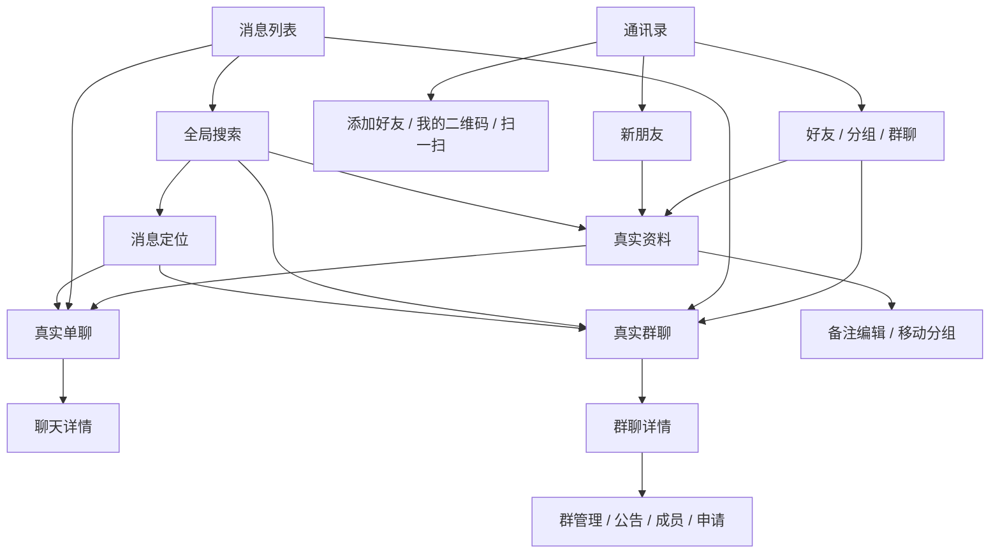

# 通讯录与真实消息 UI 设计

日期：2026-10-13。状态：开发设计与验收依据；本文不表示 UI 已接入、构建通过或真机联调完成。

## 1. 目标、范围与依据

用户已授权按产品需求开发，并在现有 UI 上补充控件。本设计让已登录用户从通讯录和消息列表完成查找、申请、分组、群选择和真实聊天；发送、审批、删除、权限变化均显示可信结果。保留四个 Tab、森林绿品牌、圆角卡片、真实头像和每个 Tab 的独立导航。

依据：[本轮授权范围](CONTACTS_MESSAGE_DEVELOPMENT_SCOPE.md)、[项目交接](PROJECT_HANDOFF.md)、[README](../README.md)、[需求总纲](CONTACTS_MESSAGE_MIGRATION_REQUIREMENTS.md)、[通讯录需求](CONTACTS_MIGRATION_REQUIREMENTS.md)、[消息与聊天需求](MESSAGE_MIGRATION_REQUIREMENTS.md)。旧项目为用户指定的 `/Users/taobotaobo/Desktop/xgd`，只作为功能与业务合同参考。实现基线为当前 `feature-message-4` 工作树；源码和实时权限优先。本轮范围文档是授权来源，需求文档中历史“待用户审阅”不覆盖当前授权。

技术约束：iOS 16、Swift 5、SwiftUI、现有 ObservableObject/Store 与 NoaChatCore SDK；头像复用 Kingfisher、RemoteAvatarURL 和当前文件 Host。一个主要类型一个文件，必要业务注释用中文。设计不增加依赖，不要求改为 Swift 6、Observation、Liquid Glass 或更高部署版本。

暂缓项不生成入口：真实拉黑/举报、支付、新发位置、群发、签到、团队、音视频、独立翻译、商城、机器人/活跃等级、独立收藏/链接模块、推送/外部深链、加密/阅后发起、主动自动清理配置、双击消息Tab定位。用户另行确认后补相应闭环。历史位置、通话和未知类型保留可识别的兼容显示。全会话主动已读入口暂不出现。好友/群业务二维码属于通讯关系功能，导航/邀请码/PC 登录扫码不纳入本设计。

设计方法采用已安装 Superpowers brainstorming/writing-plans 的需求→页面→合同→验证拆分，并用 swiftui-pro 的 views、data、navigation、accessibility、resizability 规则复核。用户已授权原 UI 增加控件，因此布局不再重复请求审批；本文只拥有设计文件，产品实现由开发任务负责。

## 2. 设计方向与语义色

| 方案 | 影响 | 选择 |
| --- | --- | --- |
| 保留现有卡片结构并补真实控件 | 页面识别稳定，现有组件可复用，改动集中在通讯录和消息 | 采用 |
| 照旧 UIKit 重建列表和顶栏 | 大幅改变新 UI，重复组件并增加适配成本 | 不采用 |
| 全站重做设计系统 | 影响首页、我的与演示页面，扩大本轮边界 | 不采用 |

当前 `ClubTheme` 为固定青绿配色；`HomeTheme` 已有森林绿和深色适配。新增通讯录、消息、聊天控件采用森林绿语义色，提取到 `Common/Design/CommunityTheme.swift`（建议名称），数值复用 HomeTheme；不要全局替换 ClubTheme 导致其他页面变化。`ClubCard`、`CommunityFilters` 等可通过默认参数保留现有调用，新增页面传入主题色；也可在功能组件外层实现相同形状。避免创建第二套头像 URL 规则。

| 语义 | 浅色 | 深色 | 用途 |
| --- | --- | --- | --- |
| 页面背景 | #F7F7F2 | #151D19 | 滚动背景、安全区背景 |
| 卡片/输入 | #FFFFFF | #202D25 | 信息卡、收到气泡、表单 |
| 主文字 | #20392D | #F0F5EC | 标题、名称、正文 |
| 次文字 | #58665C | #B9C9BD | 时间、账号、辅助文案 |
| 品牌/选中 | #285B43 | #AED5B5 | 选中标签、链接、图标 |
| 浅强调 | #E6EDE2 | #2B4031 | 自己气泡、选中行 |
| 边框 | #D8DED5 | #425449 | 卡片分隔；不是唯一交互线索 |
| 破坏/失败 | #B4233F | #FFB3C1 | 错误、删除、未读；配文字或图标 |

浅色主按钮为 #285B43 底/白字，深色主按钮为 #AED5B5 底/#202D25 字。不要使用现有 #008C86 底白小字作为新主按钮：计算对比度约 4.12:1。已计算的配色：浅色主文字/白 12.47:1、次文字/白 6.05:1、森林绿/白 7.87:1、森林绿/浅强调 6.59:1、错误/白 6.46:1；深色主文字/卡片 12.97:1、次文字/卡片 8.30:1、森林绿/卡片 8.87:1。实现后仍需检查实际 opacity、渐变、禁用色和整页效果，计算不等于全页 WCAG 验收。

## 3. 尺寸、排版和基础组件

尺寸单位 pt；下表为默认文字级别，文字放大时行高随内容增长。

| 项目 | 规范 |
| --- | --- |
| 主内容 | 保留 ClubScroll 最大 600；外边距 20，窄窗口可收至 16；正文左对齐 |
| 卡片 | 普通 22 圆角，强调 28，消息行 18；边线 1；不新增重投影 |
| 间距 | 4/8/12/16/20/24；页面区块 18～24，行内 8～14 |
| 头像 | 好友 48、会话 50、资料 88、聊天 36；圆角沿现有比例 |
| 信息行 | 默认纵向内边距 14～16，最小高度 64；头像与正文间距 12～14 |
| 输入 | 搜索最小 52；表单至少 44；正文多行，标签位于输入上方 |
| 操作 | 触控区域至少 44×44；主按钮最小高度 48，文字与 loading 不跳宽 |
| 字体 | 屏幕标题 title.bold、详情标题 title2.bold、姓名 headline/body.semibold、正文 body、辅助 subheadline、时间 caption |
| 名称 | 列表默认一行/最大两行；可访问文字级别不限高度。资料和完整正文不截断 |
| 错误 | 行内图标+正文+可执行重试，不仅红色；有缓存时放列表上方，不覆盖列表 |

复用 `ScreenHeading`、`ClubCard`、`ClubScroll`、`CommunitySearchField`、`CommunityFilters`、`CommunityRowStyle`、`EmptyClubState`、`ContactRecordAvatar`。源码现已拆成独立 Common/Components 文件，不再新增名为 CommunityComponents 的大文件。

新增基础组件责任：`CommunityActionButton` 处理标题、禁用原因和提交中；`CommunityStatusNotice` 处理加载/断网/错误与重试；`CommunityDetailRow` 处理标题、值和可选动作；`CommunityUnreadBadge` 统一数字/手动点及真实朗读值。业务计算、权限解析、网络和计数不放在组件内部。

## 4. 导航与呈现

每个 Tab 沿用现有 `ActivityNavigationScope` 中的 NavigationStack；只注册一次对应路由 destination。根页隐藏导航栏，push 的二级页恢复系统返回和 inline 标题。二级业务导航不用新建嵌套 NavigationStack；真正 sheet 表单拥有自己的 NavigationStack。现有 `ContactRecordDetailView` 的 NavigationView 在本功能改为 NavigationStack。

主任务已确定跨通讯录/消息的真实聊天合同：`ChatRoute(id:kind:title:avatarURL:)`，目标 `ChatRoomView(route:)`；每Tab导航由根注册。id+kind负责身份，title/avatarURL仅初始化展示提示，进入后仍读实时Store。搜索定位追加稳定focusMessageID的页面上下文，不以title查找原消息。资料/设置/全局搜索使用各功能路由，保存targetUID/sourceGroupID或会话稳定ID；不保存完整ContactRecord/消息快照。两模块不能定义不同的聊天目标类型。

资料、聊天、设置、搜索、申请列表用 push；备注、创建/改名分组、移动分组、选人、发送确认用系统 sheet；媒体预览/扫码根据需要用 fullScreenCover；删除/解散用 alert 或 confirmationDialog。返回资料时恢复查询和列表锚点；成功建群替换创建流程为同一真实 groupID 的聊天，取消返回原入口。

sheet 未提交可立即取消；有脏输入的退出给“放弃修改？”、“继续编辑”、“放弃修改”。提交中显示“正在保存…”等真实阶段，阻重复提交；若允许关闭，明确回页会核对结果，不把关闭当服务器取消。退出账号、俱乐部切换清页面任务和呈现状态；普通断网保留页面和草稿。

## 5. 通讯录主页面（C-001～008、022、026、033～037）

页面从上到下：`ScreenHeading(一起发现，一起参与 / 通讯录)` 与“添加好友”图标按钮；“我的好友 · N 位好友”强调卡；功能卡列表“新朋友”（真实申请未读）、可用“文件助手”、可用“群助手”；本地搜索框；“好友 / 分组 / 群聊”筛选；当前列表。

标题加号直接进入添加好友，VoiceOver“添加好友”，保持旧入口目的。创建群、扫码等统一由消息“更多”菜单进入；添加页也可提供业务扫码。分组筛选下增加右对齐文字按钮“管理分组”，不藏在长按中。群聊筛选空态可以提供已获权限的“创建群聊”。功能卡采用整行按钮，不把计数本身做为第二个按钮。

| 分类 | 查询占位 | 行内容 | 点击 |
| --- | --- | --- | --- |
| 好友 | 搜索备注、昵称、账号 | 真实头像、备注优先名称、账号、真实在线状态 | 资料 |
| 分组 | 搜索分组内好友 | 组头“名称 · N 位”、展开箭头；展开显示好友行 | 组头展开；好友资料 |
| 群聊 | 搜索已加入的群聊 | 群头像、群名、可公开人数/本人身份（有真实字段才显示） | 真实群聊天 |

好友保留当前拼音首字母分区，系统账号不计入好友。右侧字母快速定位仅显示存在分区，点击最小44触区；空间不足用“按首字母定位”Menu，不挤压姓名。在可访问文字级别使用 Menu。点击索引不打开资料、不改变未读。

分组保留 SDK ugOrder，默认组收未分配好友；组内按真实在线/离线/注销和原排序合同。在线用文字/可访问状态，不只小圆点。新群列表排序采用当前真实缓存稳定顺序，按 groupID 去重；没有来源不写“最近加入”，不从会话时间推断通讯录排序。群查询仅群名称匹配，不宣称检索公告/成员/群ID。

各分类分别保存查询、展开组、浏览锚点；切分类不横向滑动。清查询恢复该分类完整列表。注销项使用“已注销账号”，隐藏远程头像与聊天/关系操作。陌生状态/未知封禁策略不得在 UI 擅推导可发权限。

| 状态 | 标题/正文 | 动作 |
| --- | --- | --- |
| 首次同步无缓存 | 正在同步好友… / 同步完成后，好友将显示在这里。 | ProgressView；不插演示数据 |
| 无好友 | 暂无好友 / 添加好友后，可在这里查看资料并聊天。 | 添加好友，权限允许时 |
| 无群 | 暂未加入群聊 / 加入或创建群聊后，会显示在这里。 | 创建群聊，权限允许时 |
| 空业务组 | 这个分组暂无好友 / 可从好友资料中移动好友到这里。 | 保留组头、管理分组 |
| 无匹配 | 没有找到相关好友（或群聊） / 试试其他名称或账号。 | 清除搜索 |
| 缓存失败 | 列表暂时不可用 / 请重新读取，或稍后再查看。 | 重新读取 |
| 有缓存同步失败 | 暂时无法同步，已保留当前列表。 | SDK自行恢复；只给有效本地重读 |

## 6. 新朋友与添加（C-009～015、030～032）

“新朋友”顶部说明“好友申请”，申请卡含对方真实头像、名称、来源（有字段时“通过搜索/扫一扫申请”）、时间、方向、状态。第一页加载与继续分页分开；每页20是业务合同，不展示给用户。底部“加载更多”/“正在加载…”/“没有更多申请”/“加载失败，重试”，失败不跳页。

| 当前关系/方向 | 状态文案 | 主动作 |
| --- | --- | --- |
| 对方发来、待处理 | 请求添加你为好友 | 同意 |
| 本人发出、待处理 | 等待对方通过 | 无同意按钮 |
| 已是好友 | 已添加 | 发消息 |
| 本人发出、已过期且非好友 | 申请已过期 | 重新申请 |
| 对方发来、已过期且非好友 | 申请已过期 | 只读资料；允许添加时可重新申请 |
| 目标注销/不可用 | 该账号已注销（或账号暂不可用） | 关闭危险操作 |

点击整卡打开“申请详情”并检查当前关系；行右“同意”独立点击不触发行导航。提交中“正在处理…”，成功关系已确认但完整资料尚未同步时显示“已同意，正在同步好友资料…”。不插不完整好友占位冒充落库完成。

申请行侧滑/更多动作叫“在本机隐藏”。确认正文：“此申请只在当前设备隐藏，不会通知对方。”按钮“隐藏申请/取消”。不显示好友“拒绝”；隐藏是否扣未读须开发确认业务口径，未见项不自动清读。新申请不同 sendTime 可重新显示。

“添加好友”页面：本人账号卡（“我的账号”+账号+显式“复制账号”，可选“我的二维码”），标注“输入对方账号查找”；输入框默认“请输入对方账号”，搜索按钮“搜索”；成功结果卡显示头像、名称、账号和当前关系。仅后台确证支持手机号/邮箱后改占位，不沿用旧 placeholder 当支持承诺。空输入不请求，提示“请输入账号”；本人结果“这是你的账号”；空结果“未找到该用户，请检查账号”；失败“搜索失败，请稍后重试”。不会边输入边向服务器查，每次提交查询绑定最新输入版本。

非好友主按钮“添加好友”，提交“正在发送申请…”，回执成功“申请已发送，等待对方通过”；已有好友“查看资料/发消息”；本人仅个人资料。无添加权限收起主入口，已开页面显示“当前账号没有添加好友权限。”不能经搜索卡/二维码/群成员绕过。好友申请不设计未经协议支持的验证留言输入。

本人/群二维码卡显示真实头像名称、接口二维码、账号或群名、服务端有效期（存在才显示），动作“保存图片/分享/复制账号”；无内容时“二维码生成失败”+“重新生成”。扫码页“扫描好友或群二维码”，提供“从相册选择”、取消；相机拒权“无法使用相机，请在设置中开启权限。”+“打开设置/返回”。解析中停止重复识别，错误“二维码已过期/此二维码暂不可用/不支持此二维码”，可“重新扫描”。不自动打开普通URL或处理导航/PC码。

群扫码已加入→真实群聊天；需审→“申请加入群聊”，输入“申请理由”仅该真实协议有该字段，提交后“申请已提交，等待管理员审核”；无需审在真实加入回执后进入群。禁码/解散显示原因并返回，不造群记录。

## 7. 资料、备注和好友管理（C-016～019、025、038）

“好友资料”从上到下：88头像、展示名、真实账号/角色（权限允许）、“在线/离线”安全说明；资料卡（昵称、备注、备注描述、业务分组）；主按钮“发消息”；“更多”Menu：编辑备注、移动分组、推荐给朋友（真实名片发送实现可用时）、删除好友。群来源另显示“在本群的昵称”，保持 groupID 上下文；不覆盖全局昵称。本人、陌生人分别采用“个人资料/用户资料”，不出现本人添加/删除。

详情先缓存后现场刷新，加载小字“正在更新资料…”，失败“资料暂未更新，已展示已保存的信息。”已删除关系“该好友已不在通讯录中 / 返回通讯录查看最新列表。”注销“该好友账号已注销”，保留可识别信息但关闭发消息及关系提交。

备注 sheet 标题“备注与描述”，导航“取消/保存”；标签“备注”、占位“设置好友备注”；标签“备注描述”、占位“添加描述”；计数50/200沿旧 UTF-16 规则，但不能在中文 marked text 或组合 emoji 中间截断。超限保留用户输入并提示“备注最多50个计数单位，请缩短后保存。”（实现最终文案建议“备注过长，请缩短后保存。”，避免暴露编码术语）；描述对应200。全空格备注“备注不能只包含空格。”空字符串清除合法，提示“清除备注后，将显示好友昵称。”未改禁保存。失败原值不变、输入不丢，显示“保存失败，请重试”；回读阶段“已保存，正在更新资料…”。

移动 sheet“移动到分组”，Radio/checkmark 列表标当前组，选中不提交，底部“完成”；同组完成禁用；提交中保留原组真实归属。目标组消失显示“该分组已更新，请重新选择。”刷新目标列表。

删除确认：“删除好友？”正文“删除后，该好友及与其相关的聊天记录将按服务器处理结果清理，无法恢复。”若实际选定API只清某范围，必须在实现中改为真实范围。44016/44017显示“请求已受理，等待处理/已提交审核，等待处理”，继续保留当前关系，不显示“已删除”。关系完成、记录清理失败：“好友已删除，聊天记录清理未完成。”并提供对应真实恢复动作。会话列表删除不得复用该确认。

## 8. 分组管理与统一选择器（C-023～029、CHAT-024～025、037～038、042）

分组管理页“管理分组”，顶部“新增分组”；组卡显示名称、人数、改名/删除（自定义组）和移动手柄。默认组不可删除；改名/移动策略按SDK确认，未知时默认组只读。排序用系统 List.onMove 与“上移/下移”可访问动作；提交失败恢复权威顺序，不仅本地保存。

新增/改名 sheet“新增分组/修改分组名称”，输入“分组名称”，空白“请输入分组名称”，不创造未经确认长度/数量限制。删除“删除分组？”、“组内好友将移到默认分组，好友关系不受影响。”按钮“删除分组/取消”。成功回读；同名后端不允许时显示真实错误。

统一选人页面根据目的显示“创建群聊/邀请好友/选择接收人/选择成员”。包括已选可移除 chip、计数、搜索、最近/好友/分组或群候选、行 checkmark、固定底部主按钮“创建群聊（N）/邀请（N）/下一步（N）”。选择集合用UID，跨分类/搜索一致；选中名称和按钮不挤在一行大字中。

建群最少2位可选好友、最多200是旧入口客户端规则；本人不计入这两个数。单聊详情“添加成员，创建群聊”预置原好友不可取消，至少另选1位；按钮计数清楚包括预置对象。最近最多50是候选合同，非选人上限。邀请进群剔除已在群成员，容量以真实群配置/后端，不把建群200套到邀请。

不足最低数提示“至少选择2位好友”或“再选择1位好友”；达上限“最多可选择200位好友”。取消不发送不建群；成功有groupID但导航失败提供“打开群聊”，不再次创建。邀请需审显示“邀请已提交，等待审核”，不把候选立即加入成员列表。

转发/名片选择目标后给发送确认页：目标列表+消息摘要+“发送/取消”。逐对象部分失败“已发送给X个会话，Y个会话发送失败”，打开失败详情，重试只失败目标。删除/禁言/管理员/转让选择器各有自己的目标过滤，不能复用“好友可选”来保护群主。

## 9. 消息列表与会话操作（M-001～015、024～028）

消息根页：`ScreenHeading(与伙伴保持联系 / 消息)`、真实数量/同步indicator、右“更多”Menu；连接状态条；原搜索框“搜索会话或消息预览”；小字动作“搜索好友、群聊和历史消息”；全部/未读筛选；18圆角会话卡。

行布局保持50头像、名称+免打扰图标+时间、预览+未读；置顶增加图标/朗读“已置顶”并保留左强调条，不能只靠条颜色；真实@提示“有人@我/有人@所有人”，草稿前缀“草稿”；群预览有来源时“发送者：摘要”。时间无值不造时间；名称空“未命名会话”，预览空“暂无消息预览”。角标 >99 显示99+，VoiceOver朗读真实N条。手动点朗读“标记未读”，不宣称正文未读；手动点与真实数同时存在时沿已确认Store口径，不擅改统计。

原生侧滑使用 List 承载会话卡（隐藏系统行背景和分隔、行spacing10、保留内容宽与外边距）；`ScrollView+LazyVStack` 上直接 `.swipeActions` 不形成可用侧滑。若开发保留 ClubScroll，须实现可验证的侧滑交互，并同步提供 contextMenu 和 VoiceOver 动作。推荐本轮 List 行+同一 ConversationCard 组件，避免自制复杂手势。

| 类型 | 前缘滑动 | 后缘滑动/更多 | 点击 |
| --- | --- | --- | --- |
| 普通单聊/群聊 | 置顶/取消置顶 | 标记未读/标记已读，免打扰/取消免打扰，删除会话 | 对应真实聊天 |
| 文件助手 | 置顶/取消置顶 | 仅删除会话；禁免打扰/标记未读 | 真实文件助手 |
| 群系统通知 | 无通用操作 | 无通用操作 | 系统通知/审核页 |
| 暂缓独立类型 | 无 | 无 | 保持只读兼容行，不能显示可用聊天箭头 |

关闭全滑动直接删除（allowsFullSwipe:false）。会话删除确认“删除会话？”正文“会话将从消息列表移除，聊天记录仍保留。”按钮“删除会话/取消”。每会话操作pending仅禁该会话动作，禁止假提前移除/置顶；失败“操作失败，请重试”，保留原真实状态。详情Toggle同样先真实提交再回读，用小spinner表示等待。

更多Menu仅含已实现且可授权动作“添加好友/创建群聊/扫一扫”；不展示暂缓群发/支付/通话。搜索入口不受发送权限影响，但搜索目标过滤权限保持一致。双击消息Tab定位属于M-025，按本轮范围暂缓；未读筛选仍可用。文件助手置顶+删除矩阵依据主任务最新核实的旧 `CandyTalkHomeViewController.m:705` 及后续实现，优先于需求初稿“仅删除”的错误摘要。

状态条“网络已断开，已保留当前消息。”、“正在连接…”、“正在同步消息…”按真实SDK阶段。没有百分比时不造进度。缓存错误动作“重新读取”只读缓存。空态区分“暂无会话/暂无未读会话/没有找到相关会话/正在同步会话…/会话列表暂时不可用”。

## 10. 全局和会话内搜索（M-016～018、CHAT-031）

“搜索”push页，顶部 CommunitySearchField“搜索好友、群聊和历史消息”+“取消”；说明“搜索当前账号已同步到本机的数据”。输入非空后分别给“好友/群聊/聊天记录”卡片，每类先最多3项，有更多时“查看更多好友/查看更多群聊/查看更多聊天记录”。更多页保查询和类别，异步查询旧版本结果不覆盖新输入。

好友行进资料；群行进群聊；消息结果显示会话名、作者（有真实来源）、命中摘要、时间，携带稳定服务端ID去真实聊天定位。匹配突出用半粗字和背景，同时保留完整可读原句；不只靠颜色。清空清结果；无输入说明“输入关键词开始搜索”；无匹配“没有找到相关内容”；库同步中补“部分记录仍在同步，稍后可再搜索。”

定位补页spinner“正在定位消息…”，找到后短暂强调原气泡；Reduce Motion改透明度变化。无权限/已删/撤回/到期分别“该消息已不可查看/消息已删除/消息已撤回/消息已失效”，留“返回搜索/查看最新消息”显式动作，不自动跳最新冒充命中。搜索定位自身不标不存在目标为已读。

会话内“查找聊天记录”：文本/图片与视频/文件筛选，文本或文件名输入，合法群成员筛选“全部成员”。关闭成员搜索时隐藏该入口；默认查询本地最多50按SDK合同，更多仅在实际分页接口实现后显示，不承诺无限云端全文。图片网格可变列宽/数量，文件行显示名称/大小/时间，点击资源用真正下载预览。

## 11. 真实聊天主界面（CHAT-001～018、049）

采用主任务已约定的真实 `ChatRoomView(route:)`，现有演示 ChatScreen 不作为真实route目标。顶部系统返回、当前会话名称、群身份/人数（有权才显示）、“聊天详情”按钮。顶部通知/公告/消息置顶条可折叠，始终保留文本入口；当公告与消息置顶同时存在，按旧合同优先公告，消息置顶仍可从详情进入列表，不静默丢能力。

正文浅背景、收到左/本人右，36头像、群发送者（备注→本群昵称→个人昵称→安全兜底）、气泡、时间/发送状态；自己气泡浅强调，正文森林绿；多行正文可选择复制但不截断。普通宽度气泡最大占正文72%，并上限440；可访问文字级别允许90%以减少每行字数压缩。日期只首条/跨日期插分隔，不新增每5分钟规则。

历史顶部条“加载更早消息/正在加载历史消息…/没有更早消息/历史消息加载失败，重试”；首屏先展示缓存，服务器补页不清正文。历史前插锚点为消息稳定ID；图片加载前保留合理尺寸比，避免内容高度突变。正在看历史收新消息显示底部“X条新消息 · 回到最新”，不强拉；本人明确发送后可滚动到新发送记录。搜索定位/编辑/多选时保持目标锚点。滚动稳定性由实现与真机验证证明。

输入通过 `.safeAreaInset(edge:.bottom)` 置于键盘上方，与原生安全区一起适配，不用固定bottom值和覆盖层。主体多行输入“输入消息”，默认1～5行，超过在输入内滚动；按钮“语音/表情/更多工具/发送”，触区44，发送文本标签可见。Return默认换行，显式发送按钮提交；外接键盘Command+Return发送，Escape关闭工具/引用；数字/emoji键盘有“收起键盘”动作。

仅空白不能发，留输入并提示“请输入消息内容”；不擅造文字总长度限制。准备入队失败保留正文/@/引用；SDK确认本地待发记录建立后清当前编辑框，原文完整保留在待发/失败记录，避免同一段输入被连续提交；ACK成功清对应已发送草稿版本，不清用户随后输入的新内容。失败气泡“重新编辑”恢复原文及@，新正文已有内容时先确认替换，不覆盖新草稿。

| 阶段 | 气泡旁文案/表现 | 动作 |
| --- | --- | --- |
| 准备附件 | 正在处理… | 实际任务支持时取消 |
| 上传 | 正在上传…+真实进度；无百分比只spinner | 任务支持时取消；不标发送成功 |
| 等待ACK | 正在发送…+spinner | 无第二次发送入口 |
| 成功 | 已发送；已读提示受真实角色配置控制 | 按消息菜单 |
| 失败 | 发送失败+感叹号+原因摘要 | 重试/重新编辑/删除失败记录 |

发送成功依据SDK有效ACK，不插假回复。失败原因映射：无网“网络不可用，连接后重试”；连接未就绪“连接尚未就绪，请稍后重试”；连接中断“连接已中断”；文件过大“文件过大，请选择其他文件”；限频“发送过于频繁，请稍后重试”；超时“发送超时，请核对状态后重试”；非法响应“暂时无法确认发送结果”；服务端拒绝按安全的真实错误展示。人工重发前核对原记录是否已成功，复用SDK重试，不另设无限循环。

输入权限状态：暂时断网保留可编辑草稿，发送不可执行时给原因；个人禁言“你已被禁言，暂时无法发送消息。”，全员“群内已开启全员禁言。”，有可信截止时间才显示“禁言至…”。退出/被移除“你已不在此群聊中。”、解散“该群聊已解散。”、权限未知“正在确认发送权限…”。关闭发送与所有工具提交，但保留可读历史和允许的本地复制；是否仍可看旧群历史以服务端政策决定。

工具面板仅显示完整闭环项：相册、拍摄、文件、已接贴纸。语音录制最大60秒，提供明确“开始录音/停止/取消/发送”操作以支持VoiceOver；触屏按住和上滑取消为同一合同的快捷方式。拒麦“无法录音，请在设置中开启麦克风权限。”上传/转换/播放失败都有重试，离页/后台停录和停播；语音成功播放才上报语音正文已读。

相册旧最多9项，超大媒体转换文件时先核对文件上传权限，不能绕过关闭；相册/相机拒权提供打开设置，取消选择不发送。文件显示文件名、大小和真实状态“未下载/正在下载/下载失败/文件已失效”，点击下载/重试/系统预览；源文件消失“原文件不可用，请重新选择”。不把本地路径展示给用户。

@ sheet“选择提醒对象”，重名显示账号或可见附属字段，用UID绑定片段；“所有人”仅当前策略允许时出现。删除@保持完整片段，不切断UID元信息。历史不支持类型显示“暂不支持查看此消息”+发送者/时间，保留SDK原记录，不输出协议原文。历史通话显示真实状态，不能点击假发起；位置只显示真实地址和有效地点查看。

## 12. 消息菜单、引用和批量（CHAT-019～029）

长按contextMenu、VoiceOver同名动作共用当前消息操作合同，每次提交再次核对ID、成功状态、作者、时间窗和权限。已撤回/系统事件/未知类型不套普通文本完整菜单。

| 条件 | 可设计动作（实际权限与接口可用后开放） |
| --- | --- |
| 成功文本/@ | 复制、引用、转发、多选；本人且窗口允许编辑/撤回；无引用且权限允许消息置顶 |
| 成功媒体/文件 | 预览/打开、引用、转发、多选（类型矩阵允许）、授权删除 |
| 失败本人记录 | 重试、重新编辑（可恢复文本）、删除失败记录 |
| 名片/合并记录 | 查看资料/记录；按原矩阵禁多选或再合并，不生成一套全动作 |
| 他人记录 | 复制/引用等安全动作；删除/撤回仅角色范围明确允许时 |

引用栏位于输入上方“回复 · 作者/摘要”+“取消引用”；取消不清正文。点引用定位原serviceID，原文撤回/删除相应占位。编辑模式显示“正在编辑消息”+“取消编辑”，主按钮“保存修改”；取消恢复编辑前草稿，失败保编辑内容；时间窗失效提示“此消息已无法编辑。”，不给本地假替换。

多选标题“已选N条”，不可选行明确禁用，顶部“取消”，底栏“删除/逐条转发/合并转发”只显示有效动作；最多100条，101时“最多选择100条消息”。消息被实时删/撤回/状态变化自动移出选择；取消不发送，恢复输入和位置。删除确认明确“仅为我删除/为双方删除/为所有成员删除”实际可用范围；未确证范围的按钮不显示。成功回执后同步正文、引用、搜索和预览，部分失败逐条保留。

消息置顶选择“仅自己/所有成员/双方”（按会话和角色），置顶列表带原作者/摘要/范围，点击定位；它与会话置顶分开命名“置顶消息/置顶会话”。撤回占位“你撤回了一条消息/某某撤回了一条消息”；本人文本可有“重新编辑”仅完整原文确可恢复时。CHAT-029主动自动删除配置按授权范围暂缓，不生成sheet或设置入口；历史已到期/已删消息继续遵循SDK事件和兼容合同，不能以本地定时器冒充多端删除。

## 13. 聊天详情和群管理（CHAT-030、033～045）

单聊“聊天详情”：好友头像名称→“查看资料”；“添加成员，创建群聊”；卡片“查找聊天记录/置顶会话/消息免打扰”；授权危险区“清空聊天记录”。删除会话不等同清空，清空确认正文必须写当前真实API实际范围。文件助手复用历史与发送组件，但设置仅“查找聊天记录/置顶会话/清空聊天记录”，不出现好友/成群操作。

群“群聊详情”：群头像/名称/合法人数与本人身份；成员预览+“查看群成员”；邀请/移除只在合法权限时；资料卡“群二维码/群公告/我的群昵称”；消息卡“查找聊天记录/置顶会话/消息免打扰”；管理卡“群管理”（1/2）和当前待审计数；危险区“清空聊天记录/退出群聊”，群主解散放群管理危险区。

| 行/页面 | 普通成员0 | 管理员1 | 群主2 |
| --- | --- | --- | --- |
| 群名/头像 | 只读 | 按服务端可编辑 | 按服务端可编辑 |
| 成员/私聊资料 | 受可见性/私聊/groupSecurity限制 | 仍核对真实策略 | 仍核对真实策略 |
| 邀请 | 按邀请策略，需审核则提交理由 | 按策略直接/受理 | 按策略直接/受理 |
| 管理、审核、公告编辑、禁言 | 隐藏 | 逐项合法动作 | 逐项合法动作 |
| 管理员设置/转让/解散 | 隐藏 | 隐藏 | 当前群主可用 |
| 退出 | 确认后请求 | 确认后请求 | 先转让；或明确解散 |

群基本资料页“群名称/群头像”，保存与上传阶段分开，上传成功接口失败仍显示旧头像；不编造群名称长度。成员尚未同步显示“正在同步群成员…”，不把空名单当最终；成员行头像、名称、合法身份“群主/管理员”与本人“我”。查人数和查成员资料分别守卫，群禁止私聊时点头像提示“当前群聊不允许查看成员资料。”实际groupSecurity豁免由同一服务合同判断。

“我的群昵称”sheet：输入预填，提示“仅在当前群聊中显示；清空后使用个人昵称。”，旧30计数规则，未改禁保存，失败留输入。资料/预览/@成员列表最终名称随真实库回读，不能只改当前文本。

群管理信息分区：“入群申请/邀请确认”；“全员禁言/成员禁言”；“允许成员私聊/新成员查看历史/显示群提示/显示群二维码”；群主分区“设置管理员/转让群主”；危险区“解散群聊”。未批准通话/机器人/活跃项不出现。Toggle请求中禁重，失败恢复旧值；每项参数数字/字符串和单位由对应SDK适配处理。

禁言选期“10分钟/1小时/12小时/1天/7天/30天/永久”；永久二次确认“永久禁言该成员？”；解除“解除禁言”。群主/同管理等角色保护以真实合同过滤。移除确认显示“移除N位成员？”及“同时删除这些成员的群内发言”开关默认关闭；删除发言范围和部分失败在回执中分开。转让二次确认“将群主转让给姓名？”、“转让后你将不再是群主。”，失败不降身份不退出。

公告页“群公告”，每页20真实分页；置顶/普通分区、标题/正文摘要/作者/时间；详情普通只读，1/2“编辑/删除”，创建按钮“发布公告”。正文必填，失败保输入；是否“同时发送到群聊/置顶公告”须接对应真实字段；独立翻译暂缓。查看成功可确认公告已读，失败不假清未读。别人删除时“该公告已删除”，可返回列表。

退出确认“退出群聊？”正文按真实清理合同显示“退出后将清理此群的本地聊天记录。”；群主先“请先转让群主，再退出群聊。”+“转让群主/取消”；解散“解散群聊？”、“所有成员将无法继续在此群聊中发送消息。”成功再退页和清对应群。关系完成局部清理失败显示具体阶段，不复活可发入口。

## 14. 群系统通知（M-021、C-034、CHAT-041）

全局标题“群系统通知”，群来源标题“入群申请”；筛选“全部/待审核”。通知卡：群名、申请人/邀请人、申请理由（真实字段）、时间、状态；待审核合法角色提供“同意/拒绝”。已处理“已同意/已拒绝/已过期”，无重复动作。每页10，列表与分页错误分开，旧列表保留。

通知已读与审核是独立动作：卡片可见确认阅读，不自动同意。批量模式“选择申请”，已选N项，底部“同意N项/拒绝N项”，确认列申请范围；部分失败“已处理X项，Y项未完成”，失败项原因与重试，不批量伪成功。另一管理员已处理回读状态；降权/解散立即关提交，“你已没有审核权限/该群聊已解散”。系统页没有普通聊天输入栏。

## 15. UI 与业务动作合同

名称为开发建议，业务不从文案字符串推导。结果建议统一为待提交、处理中、已确认、已受理待审核、部分完成、失败、取消展示；实际模型按现有Store实现，不强制新大抽象。

| 动作 | UI输入 | 必须前置/提交前复核 | 权威结果/回流 | 用户可恢复状态 |
| --- | --- | --- | --- | --- |
| openProfile | targetUID、sourceGroupID? | 当前用户归属、资料访问权限 | 关系+资料真实回读 | 缓存/更新失败/目标失效 |
| openChat | kind、targetID、focusMessageID? | AUTH/数据库/有效目标 | 真实聊天Store就绪 | 加载失败返回；不误清读 |
| searchUser | 输入账号、queryVersion | 非空/不是本人/可添加 | 真实数组/空数组/错误 | 留输入、重试、清除 |
| apply/accept | targetUID、申请ID/方向 | 当前关系/角色/目标有效 | 回执+完整好友资料落库 | 受理、待同步、失败 |
| saveRemark | targetUID、remark、description、editVersion | 仍好友、字段校验 | API成功+完整资料+SDK回读 | 保存失败留输入 |
| mutateGroup | groupID?、名称或目标顺序 | 默认组限制、当前组存在 | SDK组/成员回读 | 原结构、待回读 |
| create/invite | 来源、selectedUIDs、preselectedUID?、理由? | 不同最低数/上限、当前好友、群策略 | 真实groupID或审核状态 | 留选择、打开已建群 |
| mutateConversation | kind、targetID、action、最新读游标 | 类型矩阵、权限、当前状态 | API回执+SDK快照 | 原状态、单会话重试 |
| sendMessage | target、draftVersion、正文/@/引用或资源 | 当前身份/禁言/上传/频控 | SDK落库+ACK/Fail | 原失败记录、重试/编辑 |
| operateMessage | stableMessageID、动作、真实范围 | 作者/类型/成功/时间窗/角色 | 原条及引用/预览/搜索回流 | 原内容、部分失败 |
| moderateGroup | groupID、targetUIDs/applyIDs、角色/期限/范围 | 群最新角色与合法目标 | 群/成员/申请真实回读 | 旧策略、待处理、部分失败 |
| clear/leave/dissolve | targetID、确认范围 | 本人角色/服务范围 | 关系与本地清理分阶段 | 成功关系不可假回滚 |

所有网络动作以当前UID、邀请码、会话generation与需要的Host版本隔离迟到回执。页内只存query、选择/焦点/展开/锚点，权威数据仍由Store/SDK管理。共享Store复用既有生命周期，不在View init创建重复SDK代理。页面一旦权限变化需刷新可见控件、已有sheet和提交守卫。

## 16. 组件目录与接入建议

建议名称是实现组织参考，等价已有组件优先；避免为每个细微样式增加独立抽象。

| 目录 | 组件/页面职责 |
| --- | --- |
| Common/Design | CommunityTheme；从现有HomeTheme值提取语义色 |
| Common/Components | CommunityActionButton、CommunityStatusNotice、CommunityDetailRow、CommunityUnreadBadge |
| Common/Navigation或App/Routing | 唯一共享资料/真实聊天路由类型与目标合同 |
| Features/Contacts/Components | ContactRow、FriendApplicationCard、ContactGroupHeader、ContactSelectionRow；复用ContactRecordAvatar |
| Features/Contacts/Views | 新朋友、申请详情、添加好友、资料、备注、分组管理/移动、建群/邀请选择、二维码/扫码 |
| Features/Message/Components | ConversationCard、ChatMessageRow、MessageBubble、MessageSendStatus、ChatComposer、ChatToolPanel、HistoryLoadControl、ReplyPreview |
| Features/Message/Views | 真实聊天、全局/会话搜索、单群详情、成员/管理/公告、群系统通知、文件助手 |
| Features/*/Services / Network/IM | 业务编排与SDK桥接；UI不直接拼HTTP路径/协议 |

接入顺序：共同路由/语义色与真实聊天最小页→资料发消息与列表点击→发送状态和分页→备注/申请→列表操作→分组/群/建群→搜索和富消息→群设置/系统通知。每批完成对应UI和业务测试后再开放入口；设计文件存在不算该批完成。

## 17. 可访问性、键盘和窗口适配

全部控件用Button/Toggle/NavigationLink语义，图标保留文字label再iconOnly；装饰头像/箭头隐藏朗读，整行只读一次有效姓名/账号/在线/状态。行主要按钮和行内同意等按钮分别朗读，不把父行 `.ignore` 导致子按钮丢失。会话示例：“张三，已置顶，消息免打扰，12条未读，草稿，周末见，10点30分”；消息示例：“我，文字消息，正文，正在发送”；失败按钮“重新发送这条消息”。选中行读“已选择”，组头读“N位，已展开/已收起”。

Dynamic Type按系统文本样式，确需自定义尺寸用iOS16可用ScaledMetric；可访问文字级别头像缩为配角、名称/账号/时间纵向、主按钮整行，表单滚动，输入标签不placeholder代替。最大字号和200%文字不能遮发送/保存/取消。禁止给所有行固定高度。

VoiceOver可完成滑动菜单等价动作、分组上/下移、录音开始/停止/取消/发送、跳最新；表单错误与完成结果需可朗读公告，不能只Toast瞬闪。长按操作有显式Menu或无障碍action。未读筛选有明确按钮。减少动态效果时关闭位移/弹簧和大滚动动画，用即时定位/透明度强调。

搜索拖动收键盘，文字表单提供键盘工具“完成”，返回不清query；聊天safeAreaInset处理键盘，不额外忽略键盘安全区。外接键盘能Tab至按钮，Escape可取消可取消的sheet，不取消已提交请求。关闭工具/引用不覆盖正文。

iPad和分屏按horizontalSizeClass/实际可用宽度，而非设备型号；保留单列600容器，聊天正文最多900居中、气泡最多440；多选chip换行/横向滚动，成员/工具使用adaptive网格最小96（大字改列表）。不在本轮强制换NavigationSplitView；窗口缩窄保留query、选择、path与草稿，状态放布局分支上层。系统sheet适应宽窄，Popover需要真实anchor；长设置页和表单均可滚动，底部安全区不硬填固定高度。

## 18. 实现后验收清单

以下为待执行检查，不是已通过记录。

- 通讯录好友/分组/群聊、申请方向、备注清空、默认组、群选择最低数与部分失败有真实数据闭环，入口不指向演示页。
- 消息行滑动实可用，长按/VoiceOver同样可操作；会话删除保历史，清空/删好友/退群不同确认范围。
- 文本与emoji发收、有效ACK、失败/重发、历史100条交叠、看历史收新、搜索重复正文定位、草稿在重进/重启恢复均有可观察证据。
- 所有提交重复点击、后台恢复、权限收回、换用户/邀请码、A→B→A、Host变化不越权不串数据；“已受理/已上传”不当最终完成。
- iPhone窄宽、横屏短高度、iPad分屏，默认与最大文字，深浅色、VoiceOver、Reduce Motion、外接键盘逐页验证；普通控件最小44，实际颜色对比度至少4.5:1正文/3:1大字及关键图标。
- 可见缓存+失败同时存在、真实空、无匹配、无权限、禁言、资料/群失效均有可执行退路；未知类型不丢原数据、不泄露协议/资源路径。
- 业务状态测试与现有Contacts/Conversations脚本、全量无签名真机目标构建分别记录；真机两端联调与多端回流另留证据。截图/交互通过前不把文档或编译成功标成UI验收通过。

交接：本设计文档完成后由root统一接入、更新PROJECT_HANDOFF功能边界和安排测试；设计任务未修改产品源码、工程、SDK或依赖，未提交。
